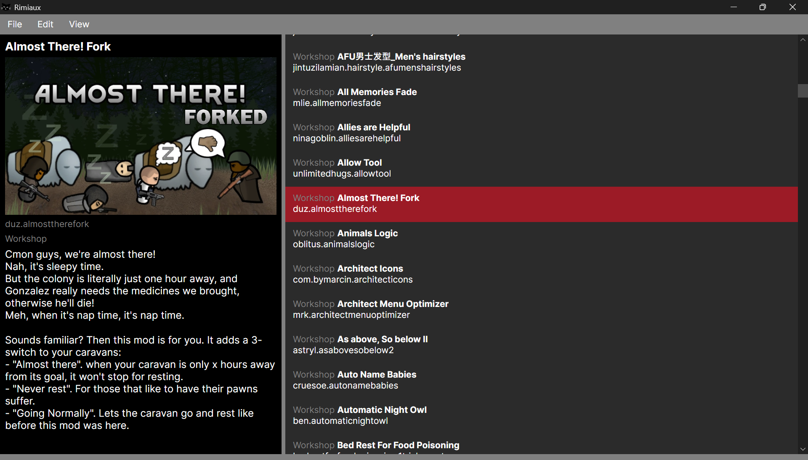

# Rimiaux

A desktop mod manager for [RimWorld](https://rimworldgame.com/), built with C# and Avalonia UI.

> **Status:** Early development. Core mod scanning works; sorting features are in progress.



## Features

- **Configurable mod folders:** set which directories to scan (e.g. your local Mods folder and Steam Workshop folder) in Settings.
- **Mod scanning:** click **Refresh** to detect every installed mod in your configured folders.
- **Alphabetical sorting:** detected mods are listed alphabetically by name.

## Roadmap

- [x] Detect installed mods from configured folders
- [x] Alphabetical sorting by mod name
- [ ] Dependency-based sorting (respect load-before/load-after rules)
- [ ] Integration with the RimSort community rules database
- [ ] Integration with the "No Version Warning" database
- [ ] Modlists: save, load, and switch between mod configurations
- [ ] Mod texture conversion

## Building from Source

### Requirements

- [.NET SDK](https://dotnet.microsoft.com/download) (version 10.0 or later)

### Run

```bash
git clone https://github.com/DrFeline/Rimiaux.git
cd Rimiaux
dotnet run --project Rimiaux
```

## Usage

1. Launch Rimiaux.
2. Open **Settings** and add the folders where your mods are installed.
3. Click **Refresh** to scan and list your mods.

## Built With

- [C#](https://learn.microsoft.com/en-us/dotnet/csharp/) / [.NET](https://dotnet.microsoft.com/)
- [Avalonia UI](https://avaloniaui.net/)
